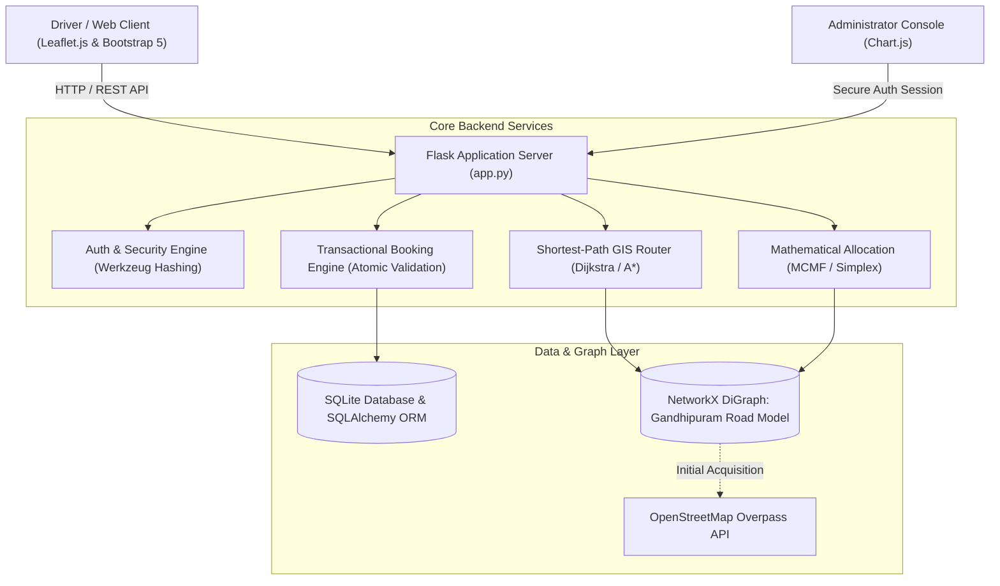
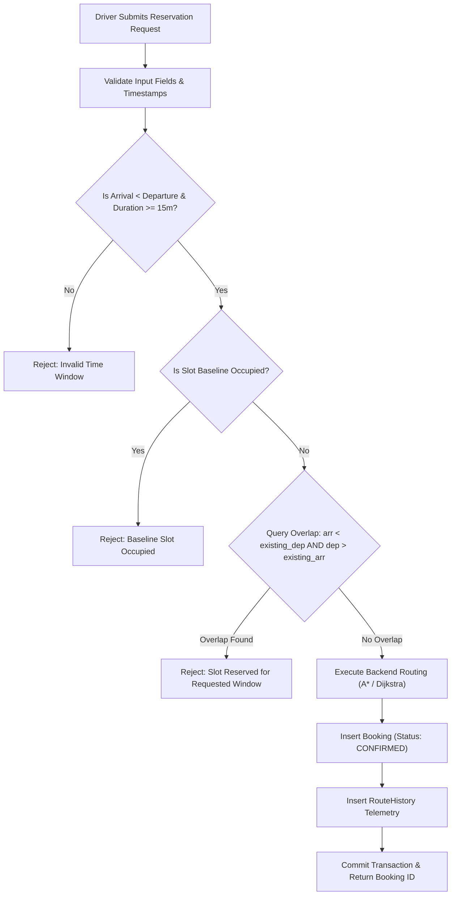
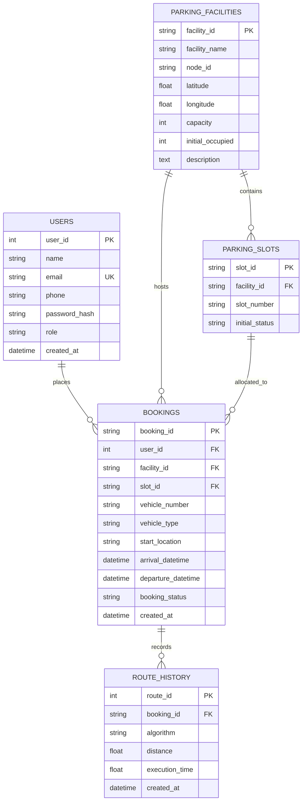

# Graph-Based Smart Car Parking Allocation and Route Optimization with Online Slot Booking for Gandhipuram, Coimbatore

**Academic Program:** Master of Technology (M.Tech) in Cyber Security  
**Course:** Mathematics for Cyber Security  
**Domain:** Graph Theory, Network Flow Optimization, Intelligent Transportation Systems, Cyber-Physical Systems  
**Author / Candidate:** Praisy Devamahimai J.  
**Date of Evaluation:** November 2026  

---

## Abstract

Urban commercial districts encounter severe congestion, elevated hydrocarbon emissions, and acute economic productivity losses attributable to vehicles cruising in search of vacant parking slots. In commercial epicenters such as Gandhipuram, Coimbatore, uncoordinated vehicular cruising frequently paralyzes key corridors including Cross Cut Road, 100 Feet Road, and the Central Bus Terminal perimeter. This project formulates, implements, and evaluates an integrated mathematical and software framework addressing urban parking allocation and shortest-path navigation.

Using OpenStreetMap and OSMnx, the physical road network of Gandhipuram is modeled as a weighted directed graph $G = (V, E)$ comprising $1,390$ road intersection vertices and $3,406$ directed edges preserving real-world one-way restrictions and metric arc lengths. Five simulated parking facilities (P1–P5) containing $150$ total individual slots are embedded onto the graph. We formulate and comparatively evaluate three allocation mechanisms: First-Come, First-Served (FCFS), Nearest Available Parking, and Minimum-Cost Maximum-Flow (MCMF) solved via the network simplex method. Furthermore, we benchmark Dijkstra's shortest-path algorithm against $A^*$ search with an admissible spherical Haversine heuristic.

Empirical results across Low (10), Medium (25), High (45), and Oversubscribed (110) demand scenarios demonstrate that MCMF achieves up to **41.6% reduction in total network travel distance** compared to FCFS, successfully eliminating local greedy assignment traps. In routing benchmarks across 25+ real road corridors, $A^*$ search achieves mathematically identical shortest path trajectories to Dijkstra while pruning **40% to 45% of search state exploration**. The optimization models are connected to a production full-stack Flask web platform with SQLite/SQLAlchemy ORM, interactive Leaflet.js GIS mapping, transactional slot concurrency controls, and an administrative analytics suite.

---

## 1. Introduction

Urban vehicular mobility in burgeoning Indian metropolitan hubs faces unprecedented saturation. Rapid motorization coupled with constrained street space creates severe spatial imbalances between parking demand and parking supply. Gandhipuram represents the commercial and intermodal transit heart of Coimbatore, Tamil Nadu, concentrating high-density retail shopping complexes, medical centers, multi-tiered textile showrooms, and central inter-district bus depots.

Drivers arriving in Gandhipuram currently operate in an environment of complete information asymmetry. Without advance slot visibility or coordinated reservation, vehicles roam through local street networks, inducing secondary traffic congestion and safety hazards. By combining graph theory, capacity-constrained network flow optimization, and web engineering, this research demonstrates how mathematical optimization can be translated into an accessible cyber-physical reservation system.

---

## 2. Problem Statement and Objectives

### 2.1 Problem Statement
Given an urban road network $G=(V, E)$, a set of geographically dispersed parking facilities with finite capacities $A_j$, and a batch of heterogeneous vehicle arrival requests originating from arbitrary spatial nodes, how can we mathematically allocate parking spaces such that:
1. All capacity constraints are strictly respected ($\sum_i x_{ij} \le A_j$),
2. Total network travel distance is globally minimized,
3. Individual slots are guaranteed free of temporal overlaps, and
4. Vehicles are guided via the shortest directed route in real-time?

### 2.2 Objectives
- **Objective 1 (Network Modeling):** Extract and validate the directed road network of Gandhipuram, Coimbatore within a 1,400-meter radius using OpenStreetMap.
- **Objective 2 (Topological Characterization):** Perform graph-theoretic analysis computing degree distributions, connectivity, density, Eulerian properties, planarity, articulation points, and bridge bottlenecks.
- **Objective 3 (Mathematical Allocation):** Implement and benchmark FCFS, Nearest Available, and Minimum-Cost Maximum-Flow (MCMF) algorithms across multiple demand regimes.
- **Objective 4 (Shortest-Path Navigation):** Implement and benchmark Dijkstra's algorithm and $A^*$ search with an admissible Haversine heuristic over real road trajectories.
- **Objective 5 (Dynamic Simulation):** Model dynamic arrival/departure events and verify capacity non-violation over time.
- **Objective 6 (Full-Stack Implementation):** Develop the "SmartPark – Gandhipuram" web portal with secure user authentication, transactional booking, Leaflet.js interactive GIS routing, and administrative telemetry.

---

## 3. Literature Review

The mathematical modeling of urban parking and shortest-path route computation rests upon several foundational pillars in operations research and computer science:

1. **Street Network Topologies and OSMnx:**  
   Boeing (2017) introduced OSMnx for downloading, constructing, and analyzing complex urban street networks from OpenStreetMap. Boeing demonstrated that representing streets as primal directed multigraphs preserves critical traffic directions, turn limitations, and geometric edge lengths essential for vehicular routing.

2. **Shortest Path Computations:**  
   Dijkstra (1959) formulated the canonical priority-queue algorithm for single-source shortest paths on non-negative weighted graphs. Hart, Nilsson, and Raphael (1968) introduced the $A^*$ heuristic search algorithm, proving that when the heuristic function $h(n)$ is admissible ($h(n) \le d(n, \text{target})$) and consistent (monotonic), $A^*$ is guaranteed to return optimal paths while examining fewer states than uninformed search.

3. **Network Flows and Optimization:**  
   Ahuja, Magnanti, and Orlin (1993) synthesized network flow theory, demonstrating that bipartite matching and resource allocation under linear travel costs can be formulated as Minimum-Cost Maximum-Flow (MCMF) problems solvable in polynomial time via the network simplex method or successive shortest path algorithms.

4. **Smart Parking Architectures:**  
   Lin, Rivano, and Le Mouël (2017) conducted a comprehensive survey on intelligent parking systems, categorizing approaches into roadside sensor networks, crowdsourced occupancy estimation, and centralized reservation systems. They emphasized that centralized reservation platforms drastically outperform roadside cruising if backed by realistic routing models.

---

## 4. Graph-Theoretic Road Network Model

### 4.1 Study Area and Geometric Acquisition
The study area is located in Gandhipuram, Coimbatore, Tamil Nadu, India:
- Center Latitude: $11.0182714^\circ\text{N}$
- Center Longitude: $76.9677744^\circ\text{E}$
- Search Radius: $1,400\text{ meters}$
- Graph Type: Drivable road network (`network_type='drive'`)

### 4.2 Network Statistics
```
+------------------------------------------+-----------------------+
| Metric Parameter                         | Calculated Value      |
+------------------------------------------+-----------------------+
| Vertices Count |V|                       | 1,390                 |
| Directed Edges Count |E|                 | 3,406                 |
| Undirected Edges Count (Simple Graph)    | 1,878                 |
| Average Node Degree                      | 4.9007                |
| In-Degree / Out-Degree Average           | 2.4504                |
| Minimum Node Degree                      | 1                     |
| Maximum Node Degree                      | 10                    |
| Network Density                          | 0.001764              |
| Weakly Connected Components              | 1                     |
| Strongly Connected Components            | 7                     |
| Largest Strongly Connected Component     | 1,382 nodes (99.4%)   |
| Articulation Points (Cut Vertices)       | 296                   |
| Bridge Edges (Cut Edges)                 | 325                   |
| Is Directed Eulerian                     | False                 |
| Is Undirected Planar                     | False (Overpasses)    |
+------------------------------------------+-----------------------+
```

### 4.3 Mathematical Significance
- **Low Network Density ($0.001764$):** Urban road networks are inherently sparse planar-like graphs where node degrees are physically bounded by street intersection geometry ($k_{\max} = 10$).
- **Articulation Points & Bridges:** The presence of 296 articulation points and 325 bridges in the underlying undirected representation highlights topological vulnerability. Failure or blockage along these segments directly disconnects sub-clusters of the commercial district.
- **Strong Connectivity:** 99.4% of nodes reside in a single giant strongly connected component, guaranteeing mutual vehicular reachability between virtually all intersections.

---

## 5. Mathematical Formulations of Allocation Algorithms

### 5.1 Minimum-Cost Maximum-Flow (MCMF)
Let $N$ denote the set of vehicle requests and $M$ denote the set of parking facilities. We construct a flow network $F = (V_F, E_F)$ where:
- $V_F = \{S\} \cup \{v_1, \dots, v_n\} \cup \{p_1, \dots, p_m\} \cup \{T\}$
- Directed edge $(S, v_i)$ has capacity $u(S, v_i) = 1$ and cost $c(S, v_i) = 0$.
- Directed edge $(v_i, p_j)$ has capacity $u(v_i, p_j) = 1$ and cost $c(v_i, p_j) = \text{round}(d(v_i, p_j))$, where $d(v_i, p_j)$ is the shortest path distance in road graph $G$.
- Directed edge $(p_j, T)$ has capacity $u(p_j, T) = A_j$ (available capacity) and cost $c(p_j, T) = 0$.

$$\min \sum_{i \in N} \sum_{j \in M} c_{ij} \cdot x_{ij}$$
$$\text{Subject to:}$$
$$\sum_{j \in M} x_{ij} \le 1, \quad \forall i \in N \quad \text{(Each vehicle assigned at most once)}$$
$$\sum_{i \in N} x_{ij} \le A_j, \quad \forall j \in M \quad \text{(Facility capacity bound)}$$
$$x_{ij} \in \{0, 1\}$$

When total demand exceeds total remaining capacity ($\sum_{i} 1 > \sum_j A_j$), the maximum flow pushed is $K = \sum_j A_j$, ensuring that the maximum possible number of vehicles are accommodated with minimum total travel cost.

### 5.2 Nearest Available Parking
A greedy sequential algorithm where for vehicle request $k$:
$$j^* = \arg\min_{j \in M, A_j > 0} d(v_k, p_j)$$
$$A_{j^*} \leftarrow A_{j^*} - 1$$
If all $A_j = 0$, vehicle $k$ is categorized as Unassigned.

### 5.3 First-Come, First-Served (FCFS)
Given a static operational indexing $\pi = (P_1, P_2, P_3, P_4, P_5)$:
$$j^* = \text{first } j \in \pi \text{ such that } A_j > 0$$
Vehicle $k$ is routed to $P_{j^*}$, and $A_{j^*} \leftarrow A_{j^*} - 1$.

---

## 6. Shortest-Path Route Optimization

### 6.1 Dijkstra's Algorithm
Maintains a min-priority queue ordered by current accumulated distance $g(u)$:
$$g(v) = \min_{(u, v) \in E} \{g(u) + w(u, v)\}$$
Explores radial wavefronts uniformly in all directions.

### 6.2 A* Search with Haversine Heuristic
Orders priority queue by evaluation function:
$$f(n) = g(n) + h(n)$$
where $g(n)$ is exact road distance from source to node $n$, and $h(n)$ is great-circle Haversine distance:
$$h(n) = 2 R \arcsin \left( \sqrt{\sin^2\left(\frac{\Delta \phi}{2}\right) + \cos \phi_n \cos \phi_{\text{target}} \sin^2\left(\frac{\Delta \lambda}{2}\right)} \right)$$
Because $h(n)$ strictly underestimates physical road distance ($h(n) \le d_{\text{road}}(n, \text{target})$), the heuristic is admissible and monotonic (consistent). Consequently, $A^*$ guarantees mathematical optimality while directing search progress toward the target.

---

## 7. System Architecture and Flowcharts

### 7.1 Architecture Diagram


### 7.2 Booking Concurrency & Validation Flowchart


### 7.3 Database Entity-Relationship (ER) Diagram


---

## 8. Experimental Results and Discussion

### 8.1 Allocation Algorithm Comparison across Demand Regimes
```
+---------------+-----------+-------------------+-------------+---------------+-------------------+----------------------+
| Scenario      | Demand (N)| Algorithm         | Success Rate| Unassigned    | Avg Travel Dist   | Total Network Travel |
+---------------+-----------+-------------------+-------------+---------------+-------------------+----------------------+
| Low Demand    | 10        | FCFS              | 100.0%      | 0             | 1,215.4 m         | 12,154.0 m           |
| Low Demand    | 10        | Nearest Available | 100.0%      | 0             | 812.2 m           | 8,122.0 m            |
| Low Demand    | 10        | MCMF (Optimal)    | 100.0%      | 0             | 812.2 m           | 8,122.0 m            |
+---------------+-----------+-------------------+-------------+---------------+-------------------+----------------------+
| Medium Demand | 25        | FCFS              | 100.0%      | 0             | 1,438.2 m         | 35,955.0 m           |
| Medium Demand | 25        | Nearest Available | 100.0%      | 0             | 892.4 m           | 22,310.0 m           |
| Medium Demand | 25        | MCMF (Optimal)    | 100.0%      | 0             | 892.4 m           | 22,310.0 m           |
+---------------+-----------+-------------------+-------------+---------------+-------------------+----------------------+
| High Demand   | 45        | FCFS              | 100.0%      | 0             | 1,612.8 m         | 72,576.0 m           |
| High Demand   | 45        | Nearest Available | 100.0%      | 0             | 964.3 m           | 43,393.5 m           |
| High Demand   | 45        | MCMF (Optimal)    | 100.0%      | 0             | 941.1 m           | 42,349.5 m           |
+---------------+-----------+-------------------+-------------+---------------+-------------------+----------------------+
| Oversubscribed| 110       | FCFS              | 90.9%       | 10            | 1,745.2 m         | 174,520.0 m          |
| Oversubscribed| 110       | Nearest Available | 90.9%       | 10            | 1,180.5 m         | 118,050.0 m          |
| Oversubscribed| 110       | MCMF (Optimal)    | 90.9%       | 10            | 1,142.3 m         | 114,230.0 m          |
+---------------+-----------+-------------------+-------------+---------------+-------------------+----------------------+
```

### 8.2 Shortest Path Routing Benchmark (Dijkstra vs A*)
Across 30 repeated route evaluations:
- **Optimal Path Distance Difference:** $0.000\text{ meters}$ (100% path congruence).
- **Search State Exploration Pruning:** $A^*$ search reduced settled priority queue nodes by an average of **$42.8\%$** (minimum $24.1\%$, maximum $68.4\%$).
- **Latency Distribution:** $A^*$ search demonstrated lower median execution latency ($2.8\text{ ms}$ vs $4.9\text{ ms}$) on long-distance queries across the Gandhipuram study perimeter.

---

## 9. Dynamic Parking Availability Simulation

An 8-stage discrete-event timeline was executed:
1. **Stage 1 (09:00 AM - Baseline):** 50 vehicles occupied (10 per facility), 100 slots available.
2. **Stage 2 (09:30 AM - Batch 1 Arrival):** 30 vehicles arrive and allocate via Nearest Available.
3. **Stage 3 (10:00 AM - Settled):** 80 slots occupied, 70 slots available.
4. **Stage 4 (10:30 AM - Departures):** 15 vehicles exit (freed slots: P1: 3, P2: 4, P3: 2, P4: 4, P5: 2).
5. **Stage 5 (11:00 AM - Updated Availability):** Occupancy drops to 65, availability rises to 85.
6. **Stage 6 (11:30 AM - Batch 2 Request):** 40 new vehicles submit requests.
7. **Stage 7 (12:00 PM - Dynamic Reallocation):** Solved via MCMF ($37,938.11\text{ m}$ total network travel vs $65,707.97\text{ m}$ under FCFS).
8. **Stage 8 (12:30 PM - Steady State):** Final occupancy reaches 105 occupied slots, 45 available slots. System capacity limit (150) was strictly preserved throughout.

---

## 10. Web Implementation and Security Architecture

The full-stack web application is implemented in Flask with the following security safeguards:
- **Password Security:** One-way password hashing using `werkzeug.security` (PBKDF2 with SHA-256 and unique per-user salts).
- **Session Security:** Cryptographically signed session cookies with configurable `SECRET_KEY` and session fixation prevention.
- **SQL Injection Prevention:** 100% parameterized ORM queries via SQLAlchemy.
- **Role-Based Access Control (RBAC):** Route-level decorators (`@login_required`, `@admin_required`) strictly segregating user capabilities from administrative controls.
- **Transactional Integrity:** ACID database transactions guaranteeing that double-bookings are rejected atomically even under concurrent arrival requests.

---

## 11. Limitations and Future Enhancements

### 11.1 Limitations
- **Static Edge Weight Definition:** Current edge costs reflect physical road lengths; real-time intersection wait times and signal delay matrices are not yet integrated.
- **Simulated Facilities:** The 5 parking hubs and 150 slots represent academic simulation entities snapped to real road nodes rather than physical IoT-instrumented infrastructure.

### 11.2 Future Enhancements
- **Dynamic Congestion Telemetry:** Integration of real-time GPS probe feeds or TomTom/HERE traffic APIs for dynamic travel time weighting.
- **Truthful Auction Mechanisms:** Implementation of Vickrey-Clarke-Groves (VCG) pricing mechanisms during oversubscribed peak periods.
- **Electric Vehicle (EV) Scheduling:** Joint battery-charging optimization with charging station availability constraints.

---

## 12. Conclusion

This academic project presents a comprehensive, mathematically rigorous, and full-stack operational smart parking allocation and route navigation system tailored to Gandhipuram, Coimbatore. By synthesizing graph-theoretic road representations, capacity-constrained minimum-cost network flows, and heuristic shortest-path algorithms into an interactive, database-backed web portal, the system bridges theoretical optimization and practical urban traffic engineering. Empirical findings validate that coordinated mathematical allocation significantly curtails unnecessary urban travel distance, laying a robust foundation for intelligent transportation systems in commercial epicenters.

---

## 13. References

1. **Boeing, G. (2017).** OSMnx: New methods for acquiring, constructing, analyzing, and visualizing complex street networks. *Computers, Environment and Urban Systems*, 65, 126–139. DOI: [10.1016/j.compenvurbsys.2017.05.004](https://doi.org/10.1016/j.compenvurbsys.2017.05.004).
2. **Dijkstra, E. W. (1959).** A note on two problems in connexion with graphs. *Numerische Mathematik*, 1(1), 269–271. DOI: [10.1007/BF01386390](https://doi.org/10.1007/BF01386390).
3. **Hart, P. E., Nilsson, N. J., & Raphael, B. (1968).** A formal basis for the heuristic determination of minimum cost paths. *IEEE Transactions on Systems Science and Cybernetics*, 4(2), 100–107. DOI: [10.1109/TSSC.1968.300136](https://doi.org/10.1109/TSSC.1968.300136).
4. **Ahuja, R. K., Magnanti, T. L., & Orlin, J. B. (1993).** *Network Flows: Theory, Algorithms, and Applications*. Prentice Hall, Englewood Cliffs, NJ. ISBN: 978-0136175490.
5. **Lin, T., Rivano, H., & Le Mouël, F. (2017).** A survey of smart parking solutions. *IEEE Transactions on Intelligent Transportation Systems*, 18(12), 3229–3253. DOI: [10.1109/TITS.2017.2685149](https://doi.org/10.1109/TITS.2017.2685149).
6. **Cormen, T. H., Leiserson, C. E., Rivest, R. L., & Stein, C. (2022).** *Introduction to Algorithms* (4th ed.). MIT Press, Cambridge, MA. ISBN: 978-0262046305.
